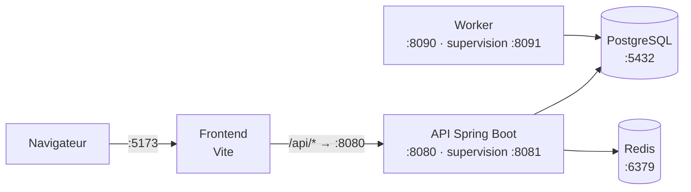
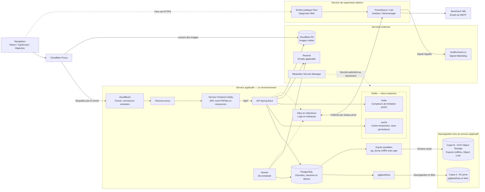

# Architecture globale

Emploi Go associe une application web React exécutée dans le navigateur, une API Spring Boot et un worker chargé des tâches en arrière-plan. Ce guide présente l'architecture retenue : le rôle de chaque composant, leurs échanges et les services d'hébergement, de supervision et de sauvegarde.

## Ce qui tourne en local

Une session de développement lance ces composants sur le poste. Le schéma montre les ports par défaut ; un port occupé est remplacé par un port libre (voir le [guide de développement](developpement.md#ports-utilisés)).

Le worker est lancé seulement avec `npm run dev:all`. PostgreSQL et Redis tournent dans Docker.

## Composants et flux

Le schéma représente un environnement déployé. Test et production disposent chacun de leurs services et de leurs données sur le serveur applicatif.

| Composant                 | Responsabilité                                                                                             |
| ------------------------- | ---------------------------------------------------------------------------------------------------------- |
| Frontend                  | Afficher les écrans, formulaires, carte et états de chargement ou d'erreur.                                |
| Cloudflare Proxy          | Recevoir les requêtes publiques et appliquer le cache HTTP autorisé.                                       |
| `cloudflared`             | Relier le serveur à Cloudflare par des connexions sortantes, sans port entrant.                            |
| Reverse proxy             | Router vers le bon environnement et service et limiter les requêtes par IP.                                |
| Serveur frontend          | Servir la SPA et les fichiers cartographiques publics, transmettre `/api/*` à l'API.                       |
| API                       | Vérifier les données, sessions et droits, appliquer les règles métier et programmer les tâches.            |
| Worker                    | Exécuter et reprendre les tâches persistantes, indépendamment des requêtes HTTP.                           |
| PostgreSQL                | Conserver les données métier, sessions et tâches.                                                          |
| Redis                     | Deux instances : `limits` pour les compteurs de limitation des actions, `cache` pour le cache temporaire.  |
| Resend                    | Envoyer les emails applicatifs.                                                                            |
| R2 images                 | Stocker les images métier, séparément des sauvegardes.                                                     |
| pgBackRest et export      | Sauvegarder PostgreSQL et archiver ses modifications (copie A), produire les exports de secours (copie B). |
| healthchecks.io           | Alerter si le signal régulier de la supervision cesse.                                                     |
| Supervision extérieure    | Collecter les métriques et logs, permettre le diagnostic et envoyer les alertes.                           |
| Bitwarden Secrets Manager | Conserver les secrets et fournir les seuls accès nécessaires à chaque service.                             |

**Le navigateur n'accède ni à PostgreSQL ni à Redis.** Le backend contrôle les données et les droits, même si le frontend masque une action ou protège une route.

## Organisation applicative

Le monorepo contient le frontend et un backend organisé par domaines métier.

| Partie                   | Technologies et organisation                                                                                                                 | Référence                                         |
| ------------------------ | -------------------------------------------------------------------------------------------------------------------------------------------- | ------------------------------------------------- |
| Frontend                 | React et TypeScript ; React Router en mode SPA et Vite. Code regroupé par fonctionnalités, avec des modules techniques communs.              | [Architecture frontend](frontend/architecture.md) |
| Interface et formulaires | shadcn/ui et Tailwind CSS ; React Hook Form et Zod.                                                                                          | [Conventions frontend](frontend/conventions.md)   |
| Données côté navigateur  | TanStack Query pour le chargement et le cache des réponses API ; `openapi-fetch` pour le transport HTTP typé.                                | [Couche API frontend](frontend/api-layer.md)      |
| Backend                  | Java 25, Spring Boot 4.1 et Spring Web MVC. Packages `api`, `application`, `domain` et `infrastructure` selon les besoins de chaque domaine. | [Architecture backend](backend/architecture.md)   |
| API et worker            | Un module Maven et un JAR commun ; une même image backend, exécutée dans deux processus distincts.                                           | [Guide worker](backend/worker.md)                 |

- React Router gère la navigation ; TanStack Query gère les données de l'API, sans cache concurrent dans le routeur.
- Les domaines backend collaborent par leurs entrées publiques d'application, sans cycle de dépendance. Le guide backend précise les dépendances autorisées et la place des annotations JPA et de validation.
- L'API et le worker ont leurs propres profils, configurations et permissions. Un profil Spring ne suffit pas à isoler les droits d'un processus.

Les versions exactes sont fixées par les fichiers de dépendances, le lock npm et le Maven Wrapper. Les commandes et mises à jour figurent dans les guides de [développement](developpement.md), de développement [frontend](frontend/developpement.md) et [backend](backend/developpement.md), et d'[outillage](outillage.md).

Les distributions retenues sont Flyway Open Source et Redis Open Source 8 avec l'option de licence AGPLv3. Conserver les obligations et attributions des distributions, dépendances et données utilisées ; voir les [licences Redis](https://redis.io/legal/licenses/). Les offres de production et le budget sont suivis dans les [questions ouvertes](questions-ouvertes.md#budget-et-offres-de-production).

## Échanges entre frontend et backend

### Routage

Le frontend appelle des chemins relatifs `/api/*` sur son origine courante. En local, Vite les transmet à l'API. En test et en production, le reverse proxy choisit l'environnement selon le nom d'hôte, puis le serveur frontend de cet environnement transmet `/api/*` à son API. Le même build frontend sert aux deux environnements, sans adresse d'API propre à chacun.

| Chemin                                 | Destination dans un environnement déployé |
| -------------------------------------- | ----------------------------------------- |
| Routes d'interface                     | Fichiers de la SPA.                       |
| `/api/*`, y compris l'authentification | API de l'environnement.                   |
| `/cartes/*`                            | Fichiers cartographiques publics.         |

**Un endpoint API inconnu ne renvoie jamais le HTML de la SPA.** Les fichiers cartographiques absents renvoient également une erreur HTTP. Voir le [routage détaillé](exploitation.md#router-les-demandes).

### Contrat API et sessions

- Les DTO et endpoints Java définissent le contrat OpenAPI produit par springdoc. `contracts/openapi.json` et les types TypeScript générés sont versionnés avec le code.
- Une modification d'API est livrée avec le contrat, les types et les adaptations frontend correspondantes. Les types générés ne valident pas le JSON à l'exécution. Voir le [guide du contrat API](api.md).
- Spring Session JDBC conserve les sessions dans PostgreSQL ; le navigateur reçoit leur identifiant dans un cookie protégé.
- Le backend vérifie la session et les droits sur les ressources, et protège les écritures contre les requêtes CSRF.

Les parcours de connexion, les règles Google et les droits administrateur sont définis dans le [périmètre fonctionnel](perimetre-v1.md#comptes-et-accès) et le [guide sécurité](securite.md).

## Cartographie et fichiers

### Fond public et points métier

MapLibre GL JS et le lecteur JavaScript `pmtiles` affichent un fond vectoriel Protomaps issu notamment d'OpenStreetMap. Le fond géographique et les données de l'application suivent deux circuits distincts.

| Contenu                           | Source et diffusion                                                                                         | Règle                                                                                             |
| --------------------------------- | ----------------------------------------------------------------------------------------------------------- | ------------------------------------------------------------------------------------------------- |
| Fond de carte                     | Archive PMTiles, style, polices, glyphes et sprites préparés hors production, puis servis sous `/cartes/*`. | Fichiers publics, sans donnée personnelle Emploi Go. Les crédits et licences accompagnent le lot. |
| Entreprises, offres et événements | PostgreSQL → API → navigateur.                                                                              | L'API contrôle la session et les droits. Modifier un point métier ne reconstruit pas le fond.     |

Les points métier restent distincts des repères du fond. L'application carte exige une connexion, tandis que les fichiers géographiques restent publics. Dijon Métropole est le territoire initial des données métier ; la couverture du fond et la recherche de lieux sont suivies dans les [questions cartographiques](questions-ouvertes.md#données-métier-et-recherche).

### Diffusion des lots

- Le service HTTP transmet les fichiers directement, sans faire passer leurs octets par Java ni demander une autorisation préalable à l'API.
- Le navigateur lit les portions nécessaires de l'archive avec des requêtes HTTP `Range`. La chaîne HTTP préserve les réponses partielles ; l'archive n'est pas compressée au niveau HTTP.
- Le service est en lecture seule. Chaque lot possède des chemins versionnés et des hashes pour identifier ses fichiers.
- Les mêmes fichiers validés en test sont promus en production. Les anciens lots restent disponibles tant qu'une version ou un client peut les utiliser.

Les contrôles de couverture, de compatibilité, de taille, d'affichage, de performance et de cache Cloudflare figurent dans l'[exploitation](exploitation.md#fichiers-cartographiques).

### Images métier

Les images suivent une autre chaîne : **contrôle par le backend → préparation avec Thumbnailator et ImageIO → encodage WebP avec `cwebp` → stockage dans R2**. PostgreSQL conserve leurs références.

Le traitement borne la taille, le temps et les ressources utilisés. L'image backend doit inclure `cwebp`, un exécutable distinct des dépendances Maven. Voir les [intégrations externes](backend/architecture.md#intégrations-externes) et le [guide sécurité](securite.md).

## Données, tâches et caches

### Données et migrations

PostgreSQL est la référence durable. Flyway versionne les migrations ; Hibernate vérifie le schéma sans le modifier. Les transactions entourent les use cases.

- **En local**, Flyway applique les migrations au démarrage.
- **Au déploiement**, une tâche Flyway dédiée termine avant le démarrage des nouveaux processus API et worker. Un échec bloque la livraison.
- **En production**, les comptes PostgreSQL API, worker, migration et administration sont distincts. Les services permanents n'ont ni droit de modifier le schéma ni secret de migration.
- **Pour un rollback**, vérifier la compatibilité de l'ancienne image avec les migrations appliquées. Revenir à une image précédente ne restaure pas les données.

Les droits et transactions sont détaillés dans le [guide données](backend/donnees.md) ; l'ordre des opérations relève de la [livraison](exploitation.md#configuration-et-migrations).

### Tâches persistantes

L'API programme les tâches dans PostgreSQL ; seul le worker les exécute avec db-scheduler. L'écriture métier et la tâche associée doivent rester cohérentes.

Un traitement peut être rejoué après une interruption. Les effets externes, comme l'envoi d'un email, exigent un retry maîtrisé et une prévention des doublons. Le [guide worker](backend/worker.md) définit les garanties, les limites transactionnelles et les règles des rappels.

### Caches et limitation des actions

| Cache                    | Usage                                                                      |
| ------------------------ | -------------------------------------------------------------------------- |
| Navigateur et Cloudflare | Ressources réutilisées selon les règles HTTP.                              |
| TanStack Query           | Réponses API en mémoire dans le frontend.                                  |
| Redis                    | Résultats temporaires côté backend, distincts des compteurs de limitation. |

Par défaut, `/api/*` reste hors cache partagé. Une exception concerne uniquement un endpoint public dont la réponse est identique pour tous, sans session, donnée personnelle ni `Set-Cookie`, avec une fraîcheur et une invalidation maîtrisées.

**Deux instances Redis par environnement séparent les compteurs de limitation et le cache.** `limits` garde les compteurs : mémoire bornée, politique `noeviction` et persistance AOF. `cache` garde le cache temporaire : politique `allkeys-lru`, sans persistance. Un cache plein évince ses propres entrées, jamais un compteur.

| Situation Redis              | Comportement                                                                                                                                                                                                                                                                                                                 |
| ---------------------------- | ---------------------------------------------------------------------------------------------------------------------------------------------------------------------------------------------------------------------------------------------------------------------------------------------------------------------------- |
| Cache indisponible ou saturé | Revenir à PostgreSQL avec des timeouts, une concurrence et une charge bornés. Une écriture de cache échouée n'annule pas une lecture valide.                                                                                                                                                                                 |
| Compteurs indisponibles      | Selon l'action : la refuser sans l'exécuter (`503`) quand elle vérifie un mot de passe ou envoie un email, l'exécuter avec un avertissement et une métrique quand son token ou son état est déjà vérifié. `429` pour un quota effectivement dépassé. Un Redis qui ne répond pas fait attendre 500 ms au plus à chaque appel. |
| Compteurs perdus             | Reprendre sans attente, avec des compteurs vides. La perte est détectée par une clé témoin, acceptée et signalée une fois par un avertissement et une métrique, sans blocage. L'AOF limite la perte à environ 1 seconde au redémarrage.                                                                                      |

Les sessions restent dans PostgreSQL et ne sont pas supprimées par une panne Redis. La limitation IP du proxy complète les compteurs applicatifs sans les remplacer. Les expirations, mises à jour atomiques et la persistance sont définies dans le [guide Redis](backend/donnees.md#redis--cache-et-protection-contre-les-abus).

## Hébergement et sécurité

L'hébergement utilise Docker Engine rootless et Compose sur Linux. Test et production partagent le serveur applicatif OVH.

| Sujet                   | Règle d'architecture                                                                                                                                                                    |
| ----------------------- | --------------------------------------------------------------------------------------------------------------------------------------------------------------------------------------- |
| Environnements          | Comptes de service, moteurs Docker, réseaux, volumes, données et secrets distincts. Limites de ressources et quotas disque pour la recette (environnement de test avant la production). |
| Accès web               | Cloudflare Proxy → tunnel `cloudflared` rootless (connexions sortantes) → reverse proxy rootless.                                                                                       |
| Protection de l'origine | Aucun port entrant pour le web : l'adresse du serveur n'expose pas le site. Un tunnel par environnement, son token est un secret.                                                       |
| Ports entrants          | Aucun port web, 443 compris. Le proxy ne publie aucun port sur l'hôte. Seul WireGuard accepte des connexions, pour l'administration.                                                    |
| Administration          | WireGuard puis SSH privé, avec comptes et clés nominatifs. Tester un accès de secours OVH indépendant avant de réserver SSH au VPN.                                                     |
| Secrets                 | Bitwarden Secrets Manager, hébergé séparément. Chaque processus reçoit ses seuls secrets nécessaires avant le lancement.                                                                |

Les règles et contrôles réseau figurent dans l'[exploitation](exploitation.md#réseau-et-https), les accès dans la [sécurité](securite.md) et les identifiants dans les [secrets](secrets.md).

**Le partage du serveur laisse un risque commun de panne ou de saturation.** Cette architecture ne fournit pas de haute disponibilité.

## Supervision et sauvegardes

### Supervision extérieure

La supervision s'exécute sur un serveur distinct pour conserver les informations déjà transmises et alerter lorsque le serveur applicatif tombe en panne.

| Partie                  | Rôle et liaison                                                                                                                                                          |
| ----------------------- | ------------------------------------------------------------------------------------------------------------------------------------------------------------------------ |
| Alloy et collecteurs    | Auprès des services : collecte des logs et métriques, avec échanges par réseau privé. Les événements de sécurité de l'hôte sont également collectés.                     |
| Prometheus et Loki      | Conservation des métriques et des logs sur le serveur de supervision.                                                                                                    |
| Grafana et Alertmanager | Consultation du diagnostic, gestion et envoi des alertes.                                                                                                                |
| Faro                    | Diagnostic technique du navigateur, filtré avant l'envoi et à la réception. Entrée HTTPS publique dédiée, sans exposition des interfaces de lecture ou d'administration. |
| Nextcloud Talk et SMTP  | Deux canaux d'alerte depuis la supervision, sans dépendre de l'API ou du worker.                                                                                         |
| healthchecks.io         | Alerte si le signal régulier de la supervision cesse. Avec un health check externe, il surveille la supervision et le site depuis l'extérieur.                           |

Faro ne suit pas les parcours et ne profile pas les utilisateurs. Les droits de lecture du diagnostic et des logs de sécurité sont distincts. La conservation, les purges, les protections de l'ingestion et les essais d'alerte relèvent de l'[exploitation](exploitation.md#supervision-et-logs).

### Sauvegardes et reprise

Les sauvegardes PostgreSQL utilisent deux copies chez deux fournisseurs différents, distinctes du stockage des images.

| Circuit                                | Fonction                                                                                                                                        |
| -------------------------------------- | ----------------------------------------------------------------------------------------------------------------------------------------------- |
| PostgreSQL → pgBackRest → copie A (R2) | Sauvegardes chiffrées et journal de modifications PostgreSQL (WAL). pgBackRest gère la rotation. Point récupérable d'environ 1 minute.          |
| PostgreSQL → `pg_dump` → copie B (OVH) | Export quotidien chiffré avec `age`, un fichier nouveau par jour. Object Lock en mode Compliance pendant 30 jours. Perte maximale de 24 heures. |

- Le serveur applicatif n'a qu'une clé d'écriture seule vers B. Il ne peut ni relire, ni supprimer, ni lever le lock. La clé privée `age` reste hors du serveur.
- Un export B permet une reprise sans A, mais ne contient ni les rôles ni les WAL postérieurs à son point de reprise.
- Les images métier, configurations, images applicatives et secrets nécessitent leurs propres sauvegardes. Les clés et accès de restauration restent récupérables sans le serveur applicatif ni le coffre d'origine.
- L'interruption tolérée est de quelques heures. Mesurer les points récupérables, les pertes et les délais lors des exercices.

Le [guide exploitation](exploitation.md#sauvegardes-et-restauration) fixe l'archivage des WAL, la conservation, les protections de B et les procédures de reprise. Le [guide secrets](secrets.md#sauvegarde-et-reprise-du-coffre) définit la récupération indépendante des accès. Les choix non tranchés figurent dans les [questions d'exploitation](questions-ouvertes.md#procédures-dexploitation).
