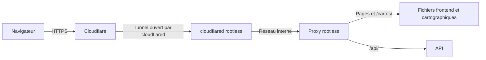

# Déployer et exploiter Emploi Go

Ce guide fixe les règles de déploiement, d'administration, de surveillance et de restauration. Les configurations serveur et les procédures d'exploitation vivent dans le dépôt `emploi-go-infra` (voir la [répartition entre dépôts](depots.md)).

## Environnements et responsabilités

| Environnement | Usage                                                                                                  |
| ------------- | ------------------------------------------------------------------------------------------------------ |
| Local         | Développer avec des données fictives. Voir le [guide de développement](developpement.md).              |
| CI            | Vérifier le code dans des services temporaires, sans accès à la production. Voir le [guide CI](ci.md). |
| Recette       | Valider une version avec des données fictives et des accès fournisseurs de test, avant la production.  |
| Production    | Servir les utilisateurs, avec surveillance et sauvegardes.                                             |

### Séparer recette et production

La recette (environnement de test avant la production) et la production partagent un serveur OVH. Pour chaque environnement, prévoir :

- Un compte Linux sans `sudo` et son moteur Docker rootless.
- Des fichiers Compose, réseaux, volumes et secrets distincts.
- Un utilisateur non root dans les conteneurs.

Limiter le CPU, la mémoire et les processus de la recette, par service et pour le compte entier. Vérifier l'application de ces limites avec [cgroup v2 et systemd](https://docs.docker.com/engine/security/rootless/tips/#limiting-resources).

cgroup v2 ne limite pas le disque. Une recette qui remplit le disque arrête aussi la production. Pour la recette :

- Appliquer un quota disque au compte Linux et à son stockage Docker.
- Limiter la taille des logs de chaque conteneur avec `max-size` et `max-file` du [driver `json-file`](https://docs.docker.com/engine/logging/drivers/json-file/), dans les deux environnements.
- Alerter sur l'espace disque libre du serveur.

Une panne ou une saturation du serveur peut affecter les deux environnements. Les administrateurs système ont également accès aux deux.

Les opérateurs autorisés déploient ; les administrateurs modifient le serveur avec leurs comptes nominatifs. Les guides [sécurité](securite.md#accès-techniques-et-exposition) et [secrets](secrets.md) détaillent les droits.

### Conserver les données

| Données                                                          | Emplacement                                                               |
| ---------------------------------------------------------------- | ------------------------------------------------------------------------- |
| Comptes, contenus métier, favoris, démarches, sessions et tâches | PostgreSQL de chaque environnement.                                       |
| Photos des établissements                                        | Dossier du serveur de l'API pour les fichiers ; PostgreSQL pour leur nom. |
| Sauvegardes et logs                                              | Stockages dédiés, hors Git.                                               |

## Réseau et HTTPS

### Chemin des requêtes



- Cloudflare redirige HTTP vers HTTPS. Le serveur n'ouvre aucun port web : ni 80, ni 443.
- `cloudflared` s'exécute dans un conteneur rootless. Il ne fait que des connexions sortantes vers Cloudflare, en TCP et UDP sur le port 7844. Les requêtes arrivent par ces connexions. Voir [Tunnel with firewall](https://developers.cloudflare.com/cloudflare-one/networks/connectors/cloudflare-tunnel/configure-tunnels/tunnel-with-firewall/).
- Seul `cloudflared` joint le proxy, par le réseau interne de l'environnement. Le proxy ne publie aucun port sur l'hôte.

Le serveur n'a donc pas d'adresse publique à filtrer ni de certificat d'origine à renouveler.

### Tunnel Cloudflare

| Liaison                    | Protection                                                       |
| -------------------------- | ---------------------------------------------------------------- |
| Navigateur → Cloudflare    | Certificat public renouvelé par Cloudflare.                      |
| Cloudflare → `cloudflared` | Tunnel chiffré, ouvert par `cloudflared`.                        |
| `cloudflared` → proxy      | Réseau interne de l'environnement, inaccessible depuis Internet. |

Règles du tunnel :

- Un tunnel par environnement, recette et production. Chacun a son token, son conteneur `cloudflared` et son réseau interne.
- La recette peut utiliser un sous-domaine de la production, par exemple `recette.emploigo.fr`. Elle doit alors respecter les règles de [cookies et sous-domaines](securite.md#cookies-et-sous-domaines), qui l'empêchent d'imposer des cookies à la production.
- Le token du tunnel est un secret : il permet d'ouvrir ce tunnel. Le ranger selon le [guide des secrets](secrets.md#réseau-supervision-et-alertes), jamais dans Git, les images, les logs ni les arguments de commande.
- Mettre `cloudflared` à jour avant la fin du support de sa version, selon la [politique de mises à jour](#mises-à-jour).
- Ne pas publier les métriques de `cloudflared` : leur [point d'écoute](https://developers.cloudflare.com/cloudflare-one/networks/connectors/cloudflare-tunnel/configure-tunnels/cloudflared-parameters/run-parameters/) reste sur le réseau interne, et la supervision les collecte par le réseau privé.
- L'accès SSH reste réservé au VPN WireGuard (voir l'[administration privée](#administration-privée)). Le tunnel ne transporte que le trafic web.

Un réplica est une seconde instance de `cloudflared` pour le même tunnel. Si l'une s'arrête, l'autre continue de servir. Cloudflare n'en choisit aucune en particulier. Voir [Tunnel availability](https://developers.cloudflare.com/cloudflare-one/networks/connectors/cloudflare-tunnel/configure-tunnels/tunnel-availability/).

- En production, utiliser deux réplicas : un remplacement ou une panne du conteneur ne coupe pas le site. Pour une mise à jour, démarrer la nouvelle version, la vérifier, puis arrêter l'ancienne.
- Garder les réplicas sur le même serveur. Deux serveurs derrière un même tunnel enverraient des requêtes à deux instances de production.
- Un seul `cloudflared` suffit pour la recette.

Une coupure du tunnel rend le site injoignable. Le health check externe la détecte (voir [Vérifier le service et la collecte](#vérifier-le-service-et-la-collecte)).

### Ports et contrôles réseau

Le serveur applicatif n'ouvre aucun port entrant pour le web. Versionner les règles du pare-feu et leur procédure de reprise dans `emploi-go-infra`.

| Connexion                                    | Règle                                                                                 |
| -------------------------------------------- | ------------------------------------------------------------------------------------- |
| `cloudflared` → Cloudflare, TCP et UDP 7844  | Autoriser en sortie.                                                                  |
| Internet → ports web du serveur, 443 compris | Refuser. Aucun port entrant n'est ouvert pour le web.                                 |
| Internet → UDP WireGuard                     | Autoriser le seul port défini pour l'[administration privée](#administration-privée). |
| Administration locale                        | Limiter aux personnes, outils et opérations autorisés.                                |

Tester depuis Internet, en IPv4 et en IPv6, que le site répond par Cloudflare et qu'aucun port web du serveur ne répond. Arrêter `cloudflared` et vérifier que l'alerte part. Refaire ces contrôles après un changement de règles et un redémarrage du serveur.

### Router les demandes

Chaque nom d'hôte dirige vers son environnement, recette ou production.

| Chemin                                          | Destination                       |
| ----------------------------------------------- | --------------------------------- |
| `/api/*`, y compris les actions sur les comptes | API.                              |
| `/cartes/*`                                     | Fichiers cartographiques publics. |
| Routes d'interface, comme `/mes-favoris`        | Frontend.                         |

Une route d'interface reçoit sa page prérendue (`/connexion` reçoit `connexion/index.html`), sinon le repli SPA `index.html`. Les pages prérendues sont décrites dans l'[architecture frontend](frontend/architecture.md#exécution-de-la-spa).

Seules les routes d'interface peuvent recevoir un fichier HTML de l'application. Une route API ou une archive absente renvoie une erreur HTTP, par exemple `404` si les règles d'accès le permettent. Le frontend affiche un message si nécessaire.

Le proxy limite les requêtes par IP. Seul `cloudflared` le joint, par le réseau interne de l'environnement : un client ne l'atteint qu'en passant par Cloudflare. Cloudflare renseigne l'adresse visiteur dans le header [`CF-Connecting-IP`](https://developers.cloudflare.com/fundamentals/reference/http-headers/#cf-connecting-ip), et le proxy ne la lit que sur les requêtes reçues de `cloudflared`. Les [compteurs Redis](backend/donnees.md#redis--cache-et-protection-contre-les-abus) ajoutent les limites propres aux actions applicatives.

Pour transmettre cette adresse à l'API, configurer `FORWARD_HEADERS_STRATEGY=NATIVE` et limiter `TRUSTED_PROXY_PATTERN` aux adresses du proxy autorisé et du serveur frontend, qui se place entre lui et l'API. Le proxy doit remplacer les headers transmis. Le serveur frontend ne garde le `X-Forwarded-For` reçu que d'une adresse privée, et y ajoute celle du proxy. L'API reste inaccessible directement. Sans proxy, conserver `FORWARD_HEADERS_STRATEGY=NONE`. Vérifier qu'un header forgé par le client ne change pas l'adresse utilisée par les quotas.

### Protections d'authentification

Règles Redis pour l'API :

- L'ACL autorise `+eval +evalsha +incr +expire +exists +pttl +get +set +del +hmget +hset` sur `~auth:limits:*`, et rien d'autre. `+del` efface les échecs et le délai d'une identité, à la réussite de la connexion comme à la récupération de mot de passe ; `+hmget +hset` lisent et écrivent les essais d'un code de confirmation ; les autres commandes servent aux compteurs. Une commande refusée rend les compteurs indisponibles à chaque appel.
- `QUOTA_KEY` (secret de l'API) est obligatoire : l'API refuse de démarrer sans elle hors du profil `local`. Elle empêche de retrouver une identité ou une adresse dans les clés Redis ; sa rotation remet les compteurs à zéro sans alerte de perte, voir les [secrets](secrets.md#clé-des-compteurs-de-quota).
- Redis écrit un journal AOF (`appendfsync everysec`) sur un volume propre à l'environnement. Un redémarrage perd au plus environ 1 seconde de compteurs. Voir la [persistance Redis](https://redis.io/docs/latest/operate/oss_and_stack/management/persistence/).
- Une perte réelle des compteurs est acceptée : l'API la signale par un avertissement et la métrique `auth_rate_limit_counters_lost_total`, sans bloquer les actions. Le premier démarrage d'un environnement, avec un volume vide, la signale une fois : c'est attendu. Voir le [guide des données](backend/donnees.md#mémoire-et-persistance).
- Le client attend Redis au plus 500 ms, à chaque appel. Un Redis qui ne répond pas ralentit donc chaque requête de 500 ms, puis la fait échouer selon le mode de panne de l'action. Redémarrer Redis ne bloque pas l'authentification : l'AOF restitue les compteurs, et une perte réelle les remet à zéro sans attente.
- Pendant une panne, les actions qui vérifient un mot de passe ou envoient un email répondent `503`, les autres s'exécutent avec un avertissement. Voir les [modes de panne](backend/donnees.md#panne-des-compteurs).
- Pendant une panne, les actions ouvertes (dont la reprise de la reconnexion) ne sont plus limitées que par la limite IP du proxy.
- Alerter, en astreinte, sur `sum(increase(auth_rate_limit_unavailable_total{outcome="refused"}[10m])) >= 3` : des actions qui vérifient un mot de passe ou envoient un email ont répondu `503`, c'est une panne visible des jeunes. Le trafic d'une Mission Locale est faible : un refus isolé est un à-coup, trois en 10 minutes une panne installée (le seuil est approximatif : `increase` extrapole aux bords de la fenêtre). Lire d'abord Redis : latence, connexions et mémoire.
- Alerter (avertissement, sans astreinte) sur `sum(increase(auth_rate_limit_unavailable_total{outcome="executed"}[5m])) > 0` pendant 15 minutes au moins : des actions ouvertes (dont la reprise de la reconnexion) s'exécutent sans compteur. Les jeunes ne voient rien, mais leurs quotas ne protègent plus : il n'y a rien à faire dans la nuit. Un à-coup isolé ne la déclenche pas : un événement ne garde l'expression vraie que 5 minutes, moins que la durée exigée. Il faut des exécutions sans compteur qui se poursuivent. Une vraie panne de Redis déclenche aussi l'alerte d'astreinte ci-dessus quand une action fermée est appelée.
- Alerter (avertissement, sans astreinte) sur toute augmentation de `auth_rate_limit_global_exceeded_total` (par exemple `increase(auth_rate_limit_global_exceeded_total[15m]) > 0`) : le seuil d'alerte global des envois d'email d'une action est dépassé, mais les envois ne sont pas refusés. Au-delà, seuls la limite par adresse, la limite par préfixe /48 IPv6, la limite par identité et le délai entre deux envois bornent le volume d'emails : une attaque répartie sur de nombreux préfixes ou de nombreuses adresses IPv4 n'est pas arrêtée par l'API. Lire les envois du fournisseur et la règle Cloudflare des routes d'email avant d'ajuster `global-alert-threshold`.
- Alerter (avertissement, sans astreinte) sur `sum by (scope) (increase(auth_rate_limit_prefix_limited_total[15m])) > 0` : un préfixe /48 IPv6 a atteint sa limite d'envois d'email. C'est une attaque qui change de réseau /60, ou un faux positif (des jeunes qui partagent le préfixe d'un opérateur). Lire l'avertissement « Limite du préfixe /48 » et les envois du fournisseur avant d'ajuster `prefix-limit`, jamais à la baisse sans mesure.
- Alerter (avertissement) quand la mémoire utilisée de l'instance Redis `limits` dépasse 70 % de `maxmemory` : sous `noeviction`, une mémoire pleine met en panne les actions fermées. Les quotas d'un /48 sont bornés (4 096 clés d'adresse par action, environ 550 Mo au total avec les identités, voir le [guide des données](backend/donnees.md#forme-des-quotas)), hors compteurs d'essais de confirmation. Un détenteur de /32 utilise jusqu'à 65 536 /48, et la limite de débit du proxy compte par adresse IP, pas par /60 ni par /48 : cette alerte est la seule protection de ce cas.
- Alerter (avertissement, sans astreinte) sur une augmentation soutenue de `auth_rate_limit_login_unrecorded_total` : des réponses de connexion n'ont pas pu être enregistrées (une remise à zéro après un succès, étiquette `outcome="succeeded"`, ou la remise à zéro après une récupération de mot de passe, étiquette `outcome="reset"`). La réponse du jeune n'a pas changé, mais les échecs de son identité restent comptés : des échecs fantômes peuvent déclencher un délai chez des jeunes légitimes, et un jeune qui a récupéré son mot de passe peut rester en délai jusqu'à son terme, ou jusqu'à ce qu'il renvoie la même requête de récupération. Cause probable : Redis lent, ou une ACL qui n'accorde pas toutes les commandes de la règle ci-dessus.
- Alerter (avertissement) sur toute augmentation de `auth_rate_limit_address_unreadable_total` : l'adresse du client n'est plus un littéral IPv4 ou IPv6 (par exemple `ip:port` transmis par le proxy), donc les quotas par adresse ne regroupent plus rien. Vérifier la chaîne de proxys et `FORWARD_HEADERS_STRATEGY`.
- Les quotas se règlent par variable d'environnement de l'API (`EMPLOI_GO_AUTH_QUOTA_SCOPES_<ACTION>_<PROPRIÉTÉ>`, voir le [guide de développement](backend/developpement.md#quota-et-timeouts-redis)) et un redémarrage. Une variable de ce nom qui ne lie rien, une propriété inconnue ou une valeur hors bornes empêche l'API de démarrer : vérifier les journaux au déploiement.
- Alerter (avertissement, sans astreinte) sur toute augmentation de `auth_rate_limit_counters_lost_total` : les quotas ont été remis à zéro, donc le volume ou l'AOF de Redis est à vérifier. Une augmentation est normale une fois, au premier démarrage d'un environnement ou après la création volontaire d'un volume Redis ; sans l'un ni l'autre, c'est une perte réelle. Une seule instance de l'API signale chaque perte : lire la somme des instances (`sum(increase(auth_rate_limit_counters_lost_total[...]))`).
- Les sessions actives restent utilisables tant que PostgreSQL fonctionne.
- Alerter sur un taux de refus soutenu du plafond de calculs de hash : la [métrique](backend/developpement.md#plafond-des-calculs-de-hash-de-mot-de-passe) signale une attaque répartie ou un plafond trop bas.
- Alerter (avertissement, sans astreinte) sur `sum(increase(auth_reconnection_reuse_revoked_total[1h])) > 0` : un ancien secret de reconnexion a été rejoué après la tolérance et sa famille a été révoquée, voir le [guide sécurité](securite.md#sessions-et-réglages-initiaux). Un événement isolé est le plus souvent un jeune revenu après une longue coupure du réseau ; plusieurs rapprochées, ou un pic par rapport au rythme habituel, évoquent un vol de cookies. Le compteur n'a pas d'étiquette et le log ne nomme aucun compte : pour les distinguer, lire les lignes de `auth_reconnections` révoquées récemment. Lire l'avertissement « Réutilisation d'un ancien secret de reconnexion : famille révoquée », qui ne contient ni secret ni identifiant.

Limites du proxy pour l'authentification, en plus des compteurs de l'API :

- **Reprise et déconnexion.** Limiter par IP `/api/auth/resume` et `/api/auth/logout`, ensemble : 120 requêtes par minute, valeur de départ. L'API ne compte pas par adresse : un cookie mal formé ou inconnu est refusé sans écriture, et une reprise réussie est comptée par reconnexion, jamais par adresse, pour ne pas refuser les jeunes d'une même salle. Seule une rafale anonyme venue d'une même IP reste à borner ici. La salle d'une Mission Locale qui ouvre le site en même temps fait quelques dizaines de requêtes par minute : la valeur garde une marge d'un ordre de grandeur. Elle se règle à partir des refus observés, jamais à la baisse sans mesure.
- **Routes d'email.** Poser une règle de limitation de débit Cloudflare sur `/api/auth/signup`, `/api/auth/signup/resend`, `/api/auth/password/forgot`, et `/api/auth/google/email`, comptées ensemble. Valeurs de départ : caractéristique « IP with NAT support », 150 requêtes en 10 minutes, action Managed Challenge. La caractéristique distingue les visiteurs qui partagent une adresse (le Wi-Fi d'une Mission Locale) par un cookie, et le défi laisse passer un jeune légitime qui l'aurait déclenché, là où un blocage le refuserait. Le seuil reste au-dessus de ce que les limites de l'API admettent par adresse en 15 minutes (40 inscriptions, 20 récupérations, 10 pour chaque parcours Google) : un atelier légitime ne voit jamais de défi. Cloudflare compte aussi les requêtes que l'API refuse. Cette règle décharge l'API des rafales venues d'une adresse ; elle ne remplace pas la limite de préfixe de l'API (`prefix-limit`), car elle ne regroupe pas les réseaux d'un même /48. Hypothèse à vérifier dans le tableau de bord de Cloudflare avant de la poser : la disponibilité de la caractéristique « IP with NAT support », du Managed Challenge et de ces périodes dépend du plan, et le blocage pourrait être réservé à l'offre Enterprise.
- **Adresse IPv6 vue par l'API.** Avec Cloudflare, l'option « Pseudo IPv4 » ne doit pas être en mode « Overwrite headers » : les clients IPv6 apparaîtraient comme des adresses IPv4, et ni le regroupement par /60 ni la limite de préfixe /48 ne s'appliqueraient. Après une demande d'email depuis une adresse IPv6, vérifier qu'une clé `auth:limits:<action>:prefix48:*` existe dans Redis : une pseudo-IPv4 est une adresse lisible, la métrique des adresses illisibles ne la signale pas.

Les [données temporaires d'authentification](backend/donnees.md#données-temporaires-dauthentification) sont purgées par la [tâche du worker](backend/worker.md#purge-des-données-temporaires), à intervalle régulier et par batches bornés, même sans trafic. L'expiration refuse les preuves sans garantir que leurs lignes ont déjà été supprimées : la rétention physique dépend de cette tâche, donc d'un worker en marche. Surveiller :

- Collecter les métriques du worker sur son port de supervision (8091 par défaut), comme celles de l'API : sans cette cible, les alertes ci-dessous n'ont aucune donnée. Les métriques sont propres à chaque worker : agréger avec `sum` ou `max`.
- Alerter quand la tâche `purge-authentication-data` échoue au moins deux fois sur une fenêtre de trois intervalles : `sum(increase(dbscheduler_task_completions_total{task="purge-authentication-data",result="failed"}[15m])) >= 2` avec l'intervalle de 5 minutes. Les données expirées restent alors en base. L'arrêt du worker pendant un déploiement n'est pas un échec.
- Alerter quand elle ne s'exécute plus, ce que la métrique d'échec ne voit pas : `time() - max(dbscheduler_task_last_run_timestamp_seconds{task="purge-authentication-data"}) > 2700`, pendant 10 minutes au moins, et `absent(dbscheduler_task_last_run_timestamp_seconds{task="purge-authentication-data"})` pour un worker arrêté ou une cible absente. Le seuil de 45 minutes est de trois intervalles plus les 30 minutes qui précèdent la reprise d'un worker mort en pleine exécution ; à recalculer si l'intervalle change. La jauge reste à zéro entre le démarrage du worker et sa première exécution : la durée évite l'alerte à chaque déploiement.
- Lire, sans alerte, `auth_purge_rows_total` (étiquette `data`) : les lignes traitées par la purge. Une valeur qui croît sans cesse sans trafic correspondant appelle de lire les logs du worker.
- Alerter (avertissement) sur le message « Purge des données temporaires d'authentification en retard » des logs du worker, qui nomme la donnée concernée : la purge a atteint son plafond de batches et n'a pas fini. Un retard de quelques exécutions suit un pic de demandes ; un retard qui dure appelle de vérifier les locks et la charge de PostgreSQL.

### Import des établissements

Le worker importe chaque jour les établissements depuis l'API Sirene de l'INSEE ([guide worker](backend/worker.md#import-des-établissements)). Une exécution manquée laisse la carte d'un jour en retard, sans gêne pour les jeunes : les alertes sont des avertissements, sans astreinte.

| Métrique                                                       | Ce qu'elle compte                                                                   |
| -------------------------------------------------------------- | ----------------------------------------------------------------------------------- |
| `dataset_synchronization_runs_total{dataset="establishments"}` | Exécutions, par issue : `complete`, `incomplete`, `interrupted`, `failed`.          |
| `establishment_synchronization_establishments_total`           | Établissements traités, par résultat : `retained`, `withheld` ou motif d'exclusion. |
| `establishment_directory_requests_total`                       | Requêtes à l'API Sirene, par issue : `ok`, `rate-limited`, `failed`, `refused`.     |

- Alerter quand aucune exécution n'a été complète depuis 48 heures : `sum(increase(dataset_synchronization_runs_total{dataset="establishments",outcome="complete"}[48h])) == 0`. Sans exécution complète, les établissements des entreprises cessées restent affichés. Lire le message « établissements lus sur … annoncés » des logs du worker.
- Alerter sur `sum(increase(dataset_synchronization_runs_total{dataset="establishments",outcome="failed"}[24h])) >= 4` : l'exécution et ses trois reprises ont échoué. Lire `establishment_directory_requests_total` : beaucoup de `failed` ou de `rate-limited` désigne l'API ; beaucoup de `refused` désigne la clé (401, 403) ; sinon la base.

### Import des fichiers ouverts

Le worker copie chaque nuit les arrêts Divia, les adresses de la métropole et la liste des organismes de formation ([guide worker](backend/worker.md#import-des-fichiers-ouverts)). Une copie de quelques jours reste juste : les alertes sont des avertissements, sans astreinte.

| Métrique                             | Ce qu'elle compte                                                                                                                                       |
| ------------------------------------ | ------------------------------------------------------------------------------------------------------------------------------------------------------- |
| `dataset_synchronization_runs_total` | Exécutions, par jeu de données (`transit-stops`, `addresses`, `training-organizations`) et par issue : `updated`, `unchanged`, `interrupted`, `failed`. |

- Alerter sur `sum by (dataset) (increase(dataset_synchronization_runs_total{outcome="failed"}[24h])) >= 4` : l'exécution et ses trois reprises ont échoué. Le message d'échec, dans les logs du worker, donne la cause : statut de la réponse, réponse incomplète (délai, réseau ou fichier plus gros que la limite) ou fichier refusé.
- Lire, sans alerte, la date de publication de chaque copie (`dataset_publications` en base) : une date qui ne bouge plus pendant des mois peut signaler une source qui publie ailleurs.

### Premier démarrage

Sur une base neuve, restaurée sans les données de référence ou remise à zéro, le worker lance au démarrage les imports jamais réussis ([guide worker](backend/worker.md#premier-import)) : aucune intervention en base. Les établissements suivent les organismes de formation et demandent `SIRENE_API_KEY`.

- Les logs du worker affichent « Premier import de `<tâche>` : lancé … » pour chaque tâche avancée (`synchronize-transit-stops`, `synchronize-addresses`, `synchronize-training-organizations`, `synchronize-establishments`). Une réussite écrit ensuite « Import des … » avec son issue ; un échec est journalisé par db-scheduler avec le nom de la tâche et compté dans `dataset_synchronization_runs_total{outcome="failed"}`.
- Pour vérifier qu'un premier import a réussi : une ligne par jeu de données dans `dataset_publications`, des lignes dans `establishments`.
- Un import qui échoue encore après ses reprises : corriger la cause, puis redémarrer le worker, qui le relance. Un redémarrage pendant les reprises ne change rien : la reprise prévue garde son heure.

### Sauvegarder les photos des établissements

Le dossier des photos est copié chaque jour avec l'export de secours de B, dans une archive chiffrée avec `age`. Une restauration remet ensemble la base et le dossier : un nom de fichier sans fichier montre le visuel du secteur.

## Administration privée

WireGuard relie les appareils d'administration et le serveur de supervision. Chaque appareil a sa propre clé et son adresse VPN.

- Définir le port UDP public de WireGuard ; limiter les autres ports accessibles à chaque appareil.
- Réserver SSH au VPN sur les deux serveurs.
- Utiliser des comptes Linux et clés SSH nominatifs. Chiffrer les postes et protéger les clés par phrase secrète.
- Donner à la supervision les accès de collecte, sans administration SSH.
- Protéger les comptes OVH nominatifs ou délégués par MFA.

**Avant de réserver SSH au VPN, tester un accès de secours indépendant du VPN et du système installé.** Selon l'offre OVH, utiliser une console ou un système temporaire de réparation. Noter l'offre, le système, la procédure, les personnes autorisées et le résultat de l'essai.

Suivre les comptes, droits et changements de configuration. Appliquer la [politique de mises à jour](#mises-à-jour). Ne pas exposer le socket Docker classique ni le monter dans un conteneur applicatif : il permet de commander Docker.

## Mises à jour

Un serveur ou une image non mis à jour garde ses failles connues. Cette politique vaut pour les deux serveurs et les deux environnements.

| Élément             | Règle                                                                                                                                                                                                                                                                | Pourquoi                                                                          |
| ------------------- | -------------------------------------------------------------------------------------------------------------------------------------------------------------------------------------------------------------------------------------------------------------------- | --------------------------------------------------------------------------------- |
| Système             | Installer automatiquement les mises à jour de sécurité (`unattended-upgrades`).                                                                                                                                                                                      | Corriger les failles sans attendre une intervention.                              |
| Services du système | Redémarrer les services qui utilisent une bibliothèque mise à jour (`needrestart`).                                                                                                                                                                                  | Un service garde en mémoire la bibliothèque corrigée sur le disque.               |
| Serveur             | Redémarrer chaque mois, à une heure planifiée.                                                                                                                                                                                                                       | Appliquer les nouveaux noyaux et vérifier que tout redémarre seul.                |
| Images              | Reconstruire chaque mois les images du projet, dont PostgreSQL avec pgBackRest, même sans changement de code. Reprendre les nouveaux digests des images tierces. Livrer par la recette puis la production, comme toute version.                                      | Reprendre les correctifs des images de base.                                      |
| `cloudflared`       | Mettre à jour avant la fin du support de la version utilisée. Cloudflare ne prend en charge que les [versions publiées depuis moins d'un an](https://developers.cloudflare.com/cloudflare-one/networks/connectors/cloudflare-tunnel/downloads/#deprecated-releases). | Une version trop ancienne peut casser à cause d'un changement sans compatibilité. |

Le redémarrage mensuel coupe les deux environnements. Après chaque redémarrage, vérifier que les services, les sauvegardes et la supervision ont repris. Pour `cloudflared`, changer l'image avec les [réplicas](#tunnel-cloudflare) évite la coupure.

## Livraison et recette

Construire, déployer en recette, vérifier, puis déployer les mêmes versions en production.

### Construire et identifier une version

Poser un tag Git de version candidate `vX.Y.Z-rc.N` sur le commit vérifié de `main` ou `maintenance/<série>`. Ce tag déclenche la [publication des images](ci.md#publication-des-images) dans le registre privé GHCR, après les vérifications. Le résumé de l'exécution donne les digests et sert de lien vers la publication.

`N` numérote les candidates d'une même version, à partir de 1. Une candidate refusée en recette n'est pas corrigée sur place : le correctif passe par une PR, puis un nouveau tag `vX.Y.Z-rc.N+1` est posé sur le nouveau commit.

Une même image backend sert à l'API et au worker. Les deux services ont leurs propres profils, configurations, accès réseau et secrets.

Les contrôles de PR ne publient ni ne déploient de version. Les jobs GitHub n'ont ni secrets ni accès SSH de production. Un opérateur autorisé déclenche le déploiement manuellement.

| Référence        | Utilité                                                          |
| ---------------- | ---------------------------------------------------------------- |
| SHA applicatif   | Identifier le commit construit.                                  |
| Digest d'image   | Sélectionner son contenu exact.                                  |
| Tag d'image      | Nommer l'image ; sa cible peut changer, contrairement au digest. |
| Tag Git `-rc.N`  | Proposer un commit à la recette et construire ses images.        |
| Tag Git `vX.Y.Z` | Identifier le commit accepté après recette.                      |
| Release          | Regrouper les notes, SHA, digests et fichiers validés.           |
| Hash de fichier  | Vérifier le contenu d'un fichier cartographique.                 |

Numéroter les versions `vX.Y.Z`, avec `v0.x.y` possible pour le pilote. Le périmètre fonctionnel V1 ne fixe pas le numéro de version. Ne jamais déplacer un tag publié, version candidate comprise. Flyway utilise une numérotation distincte pour les migrations.

### Sélectionner, tester et promouvoir

1. Sélectionner. Ouvrir une PR dans `emploi-go-infra` : digests, SHA applicatif, lien vers la publication et références du lot cartographique avec ses hashes.
2. Déployer en recette. Après revue et fusion, fournir la configuration et les secrets, appliquer les migrations, puis démarrer les services.
3. Faire la recette. Vérifier les critères de l'issue, parcours essentiels, droits et refus, mobile, accessibilité, erreurs, performances et migrations.
4. Valider. Noter les versions testées, résultats et défauts. Poser le tag `vX.Y.Z` sur le commit de la version candidate acceptée, même si `main` a avancé : le workflow ajoute ce tag aux images testées, sans les reconstruire. Publier ensuite la release.
5. Déployer en production. Sélectionner les mêmes images et fichiers par une autre PR. Après revue et fusion, déployer au moment autorisé et vérifier le fonctionnement et la version en service.

Ne pas reconstruire les images ni régénérer les fichiers entre la recette et la production. Publier une image, un tag ou une release ne déclenche pas le déploiement.

| Résultat de recette                                                                               | Décision                                                                                |
| ------------------------------------------------------------------------------------------------- | --------------------------------------------------------------------------------------- |
| Parcours essentiel bloqué, accès non autorisé, données exposées ou corrompues, usage impraticable | Refuser la livraison.                                                                   |
| Défaut mineur                                                                                     | Obtenir une acceptation explicite et créer une issue avec priorité et version affectée. |

Après chaque déploiement, noter : date, opérateur, commit d'infrastructure, release, digests, lot cartographique, résultat et incidents. Vérifier la version réellement en service, pas seulement celle indiquée dans la configuration.

Prévoir une éventuelle coupure : Docker Compose sur un seul serveur ne garantit pas un remplacement sans interruption.

### Configuration et migrations

Utiliser les mêmes images en recette et en production :

- Fournir la configuration backend et les secrets au démarrage.
- Appeler `/api/` depuis le frontend, sans `VITE_API_URL` propre à l'environnement dans le build.
- Fournir les éventuels paramètres publics, comme le chemin du fond de carte, dans une configuration lue au lancement. Adapter son cache pour éviter les valeurs périmées. Aucun secret ne doit être accessible au navigateur.

Une migration est un script versionné qui modifie la structure ou les données PostgreSQL. Flyway applique les scripts nécessaires à la version choisie.

| Compte PostgreSQL, distinct par environnement | Usage                                                       |
| --------------------------------------------- | ----------------------------------------------------------- |
| Migration                                     | Modifier le schéma avec Flyway.                             |
| API                                           | Exécuter les actions applicatives et programmer les tâches. |
| Worker                                        | Exécuter les tâches et accéder aux données nécessaires.     |
| Administration                                | Effectuer les opérations d'exploitation autorisées.         |

Les guides [données](backend/donnees.md#postgresql-et-migrations) et [secrets](secrets.md#inventaire-et-séparation-des-droits) détaillent les droits et identifiants.

1. Avant la première livraison, créer les extensions dans la base avec le compte d'administration (`CREATE EXTENSION postgis`, puis `unaccent` et `pg_trgm`, dans le schéma `public`) : la migration ne peut pas créer PostGIS sans privilège de superutilisateur ([données](backend/donnees.md#extension-postgis)), ni les deux autres sans le droit `CREATE` sur la base ([recherche](backend/donnees.md#recherche-sans-accent-ni-casse)).
   Avec le même compte, régler une fois le compte de l'API pour que PostgreSQL ne journalise jamais la valeur de ses paramètres, qui portent la position d'un jeune ([API](backend/api.md#position-du-jeune)) :

   ```sql
   ALTER ROLE <compte de l'API> SET log_parameter_max_length = 0;
   ALTER ROLE <compte de l'API> SET log_parameter_max_length_on_error = 0;
   ```

2. Exécuter Flyway dans une tâche dédiée avec le compte de migration.
3. En cas d'échec, arrêter la livraison et examiner la base.
4. Avec le compte de migration, donner les droits de la carte aux comptes de l'API et du worker. Le script se rejoue sans effet de bord :

   ```bash
   psql -v ON_ERROR_STOP=1 -v api=<compte de l'API> -v worker=<compte du worker> -f backend/src/main/resources/db/grants/map.sql
   ```

5. Après réussite, démarrer l'API et le worker avec leurs seuls comptes applicatifs : aucun secret d'administration ou de migration, ni droit de modifier le schéma.
6. Vérifier la version et la disponibilité des services. Seul le worker exécute les tâches.

| Réglage des services permanents de production | Effet                                        |
| --------------------------------------------- | -------------------------------------------- |
| `spring.flyway.enabled=false`                 | Ne pas relancer les migrations au démarrage. |
| `spring.jpa.hibernate.ddl-auto=validate`      | Vérifier le schéma sans le modifier.         |

Voir les [propriétés Spring Boot](https://docs.spring.io/spring-boot/appendix/application-properties/index.html). En développement local, les migrations restent automatiques au démarrage.

### Données de recette et correctifs d'anciennes versions

Utiliser des données fictives reproductibles, versionnées et enrichies avec le code. Ne pas copier les données personnelles de production. Le site de recette est distinct des services temporaires de CI.

Réserver les remises à zéro à la recette, après vérification de la cible. Une remise à zéro supprime les données de l'environnement : vérifier la cible avant de l'exécuter. Tester aussi les migrations sur une base déjà remplie : une installation sur base vide ne valide pas une mise à niveau.

Pour corriger une ancienne version :

1. Suivre les [règles de maintenance](../CONTRIBUTING.md#corriger-une-ancienne-version).
2. Réserver le site de recette. Si son schéma est trop récent, le recréer à la version de production avec des données fictives.
3. Construire le commit corrigé complet, puis suivre la recette et la livraison habituelles.
4. Tester la mise à niveau de cette base corrigée vers la prochaine version, sans réinitialiser la production.

Vérifier l'ordre et les dépendances des migrations sur l'ancienne version et vers `main`. Après le premier déploiement, ajouter un script plutôt que modifier une migration ([règle](backend/donnees.md#faire-évoluer-une-migration)). Ne pas autoriser l'exécution hors ordre pour masquer une incompatibilité. Toute transformation destructive demande une sauvegarde vérifiée et une procédure dédiée.

### Rollback

Revenir à l'ancienne image ne restaure pas l'ancienne base. Avant chaque livraison, choisir la version de retour et vérifier sa compatibilité avec les migrations.

| Situation                          | Action                                                                                                                                             |
| ---------------------------------- | -------------------------------------------------------------------------------------------------------------------------------------------------- |
| Ancienne application compatible    | Reprendre ses images et sa configuration validées, puis vérifier le service.                                                                       |
| Ancienne application incompatible  | Préparer une correction compatible ou une restauration contrôlée.                                                                                  |
| Restauration de la base nécessaire | Évaluer les données perdues et les effets sur les utilisateurs et les tâches. Suivre la [procédure de restauration](#sauvegardes-et-restauration). |

Noter la position dans les WAL (LSN) de PostgreSQL avant chaque migration. Elle permet de restaurer la base à cet instant, avec les WAL archivés. Pour éviter d'en arriver là, appliquer la règle [expand/contract](backend/donnees.md#faire-évoluer-une-migration) : Flyway Open Source n'annule pas une migration.

Arrêter les écritures et traitements lorsque l'opération l'exige. Éviter de rejouer les actions déjà effectuées : un email envoyé reste envoyé après restauration. Voir les [règles du worker](backend/worker.md).

Noter toute intervention urgente dans une issue ou une PR. Faire relire après l'incident les actions qui ont dérogé au parcours habituel.

### Fichiers cartographiques

Servir les fichiers sous `/cartes/`, sans passage par Java. Un lot contient les archives PMTiles, le style, les polices, les ressources graphiques, leurs licences, attributions et hashes. Il reste distinct des points métier et peut être livré hors de l'image frontend.

Versionner les scripts dans `emploi-go-infra` :

1. Préparer le lot avant la recette.
2. Vérifier l'affichage, la lecture HTTP partielle des archives et le cache.
3. Publier les mêmes fichiers en production, puis basculer leurs références.
4. Garder le lot précédent en cas d'échec et les versions nécessaires aux clients encore ouverts ou au rollback.

Le lieu et la fréquence de génération figurent dans les [questions d'exploitation](questions-ouvertes.md#procédures-dexploitation).

Règles pour les fichiers de carte (`/cartes/*`) :

- Lecture HTTP partielle obligatoire : une requête `Range` valide reçoit `206` et `Content-Range`.
- Ne pas recompresser l'archive en HTTP.
- Un fichier absent reçoit `404`, sans renvoyer le HTML de l'application.
- Les noms de dossier versionnés permettent un cache long `immutable`.
- Vérifier ces réponses sur le serveur statique, le proxy et Cloudflare.

Voir la [préparation des ressources](cartographie.md#mettre-à-jour-la-carte).

### Cache des fichiers servis

Le cache dépend du type de fichier. Les headers de sécurité sont décrits dans [Headers HTTP](securite.md#headers-http).

| Fichier                                       | Header                                               | Pourquoi                                                                                                                       |
| --------------------------------------------- | ---------------------------------------------------- | ------------------------------------------------------------------------------------------------------------------------------ |
| Pages HTML (`index.html`, pages prérendues)   | `Cache-Control: no-cache`                            | Le navigateur les revalide à chaque visite. Sinon, après un déploiement, il garde une page qui réclame des fichiers supprimés. |
| Fichiers de build `/assets/*` (nom avec hash) | `Cache-Control: public, max-age=31536000, immutable` | Le nom change quand le contenu change : le fichier peut être gardé un an.                                                      |
| Fond de carte `/cartes/<dossier versionné>/`  | `immutable`                                          | Même principe, voir [Fichiers cartographiques](#fichiers-cartographiques).                                                     |
| Réponses `/api` sensibles                     | `Cache-Control: no-store`                            | Une réponse de compte ou de session ne doit jamais être conservée par un cache.                                                |
| Photos `/api/establishment-images/*`          | `Cache-Control: max-age=86400, private`              | Une photo remplacée prend un nouveau nom : le navigateur peut garder l'ancienne un jour, aucun cache partagé ne la garde.      |

### Photos des établissements

L'API sert les photos des établissements depuis le dossier `ESTABLISHMENT_IMAGES_DIRECTORY` de son serveur, aux seuls comptes jeunes. Sans photo, la carte montre le visuel du secteur. Pour déposer une photo :

1. La préparer en WebP, en 640 × 480 pixels environ, sans personne reconnaissable ni donnée personnelle.
2. La nommer avec des lettres non accentuées, des chiffres, `-` ou `_`, et l'extension `.webp`, `.png` ou `.jpg` (100 caractères au plus). Une photo remplacée prend un nouveau nom.
3. La copier dans le dossier, lisible par le compte de l'API.
4. Renseigner son nom dans la colonne `image_file` de l'établissement, comme décrit dans [Publier un établissement](backend/donnees.md#publier-un-établissement).

Le dossier fait partie des [sauvegardes](#sauvegarder-les-photos-des-établissements).

## Supervision et logs

### Outils et accès

Héberger Prometheus, Loki, Grafana et Alertmanager sur un serveur distinct. Les échanges avec le serveur applicatif passent par le réseau privé.

| Outil                  | Fonction                                                             |
| ---------------------- | -------------------------------------------------------------------- |
| Prometheus             | Collecter et conserver les mesures : temps de réponse, mémoire, etc. |
| Loki                   | Conserver et rechercher les logs.                                    |
| Grafana                | Afficher les mesures et logs.                                        |
| Alertmanager           | Regrouper les alertes et organiser leur envoi.                       |
| Alloy et autres agents | Récupérer et transmettre les informations des services.              |

Prometheus peut récupérer les mesures directement ou les recevoir d'un agent. Choisir un seul mode de collecte par source pour éviter les doublons. Les agents restent auprès des services ; Loki reste sur le serveur de supervision.

| Accès                  | Droits                                                                                 |
| ---------------------- | -------------------------------------------------------------------------------------- |
| Diagnostic développeur | Lire Faro, les logs techniques filtrés et les mesures utiles, y compris en production. |
| Sécurité               | Lire les logs de sécurité, pour les seules personnes habilitées.                       |
| Administration         | Gérer utilisateurs, sources, alertes et conservation.                                  |
| Envoi                  | Transmettre les données, sans lecture, suppression ni administration.                  |

Protéger les interfaces de gestion et de collecte selon ces droits.

### Séparer diagnostic et sécurité

Un tenant Loki est un espace de logs, comme « diagnostic » ou « sécurité ». Le header `X-Scope-OrgID` le désigne sans authentifier l'appelant.

Le gateway devant Loki doit :

- Authentifier chaque personne ou programme et imposer son espace et ses opérations autorisés.
- Bloquer le choix libre d'un autre espace, les lectures regroupant plusieurs espaces et les suppressions non autorisées.
- Empêcher tout accès direct contournant ces contrôles.

Ainsi, changer un header ne donne pas accès aux logs de sécurité. Voir l'[authentification Loki](https://grafana.com/docs/loki/latest/operations/authentication/).

Dans Grafana OSS, séparer diagnostic et sécurité en organisations distinctes, avec leurs sources et identifiants autorisés. Masquer un tableau de bord ne protège pas sa source. Voir les [permissions Grafana](https://grafana.com/docs/grafana/latest/administration/roles-and-permissions/).

### Vérifier le service et la collecte

Un health check est un contrôle automatique répété.

| Contrôle    | Vérification                                                                                                                                                                                                        |
| ----------- | ------------------------------------------------------------------------------------------------------------------------------------------------------------------------------------------------------------------- |
| Site public | Un health check externe obtient une réponse actuelle de l'application via Cloudflare, sans cache. Il s'exécute sur un autre réseau que le serveur applicatif et que celui de supervision.                           |
| Collecte    | Le signal régulier d'Alertmanager (alerte `Watchdog`, toujours active) est reçu par [healthchecks.io](https://healthchecks.io/docs/), qui alerte s'il cesse. Il détecte aussi la panne de la supervision elle-même. |

La collecte entre serveurs utilise le réseau privé ; elle n'a pas à passer par Cloudflare. L'alerte de healthchecks.io ne passe pas par le serveur de supervision. Tester séparément Faro depuis le navigateur. Un journal SSH vide ne prouve pas que la collecte fonctionne.

Surveiller les dépendances, ressources, disques, expirations, collecte, sauvegardes et restaurations. Collecter les événements utiles :

- Connexions SSH, usages de privilèges et changements de comptes ou de configuration.
- Erreurs et arrêts de WireGuard, Docker et des collecteurs.
- Événements applicatifs de sécurité.

Limiter les fichiers audités et le volume ; ne pas enregistrer toutes les commandes. Les logs déjà transmis survivent à la perte du serveur applicatif, mais un attaquant avec des droits système peut bloquer ou falsifier les envois suivants.

### Conservation et diagnostic navigateur

| Données                                           | Conservation glissante                                                        |
| ------------------------------------------------- | ----------------------------------------------------------------------------- |
| Rapports Faro filtrés, mesures et logs techniques | 30 jours.                                                                     |
| Logs de sécurité ciblés                           | 6 mois, à justifier selon les besoins d'enquête et les traitements concernés. |

Configurer et vérifier les purges, notamment la [rétention Loki](https://grafana.com/docs/loki/latest/operations/storage/retention/). Prévoir aussi la suppression des copies, exports et notifications. Les six mois suivent les [recommandations CNIL](https://www.cnil.fr/fr/securite-tracer-les-operations), sans être une durée légale universelle.

Pour Faro :

- Collecter uniquement le diagnostic autorisé par les guides [sécurité](securite.md#diagnostic-et-incidents) et [qualité frontend](frontend/qualite.md#sécurité-et-confidentialité).
- Fournir une adresse publique d'envoi vers la supervision : le navigateur n'utilise pas WireGuard.
- Valider et limiter les envois, filtrer avant l'envoi et à la réception. Ne pas exposer les interfaces de lecture ou d'administration.

### Envoyer et tester les alertes

Envoyer les alertes aux responsables autorisés par Nextcloud Talk et par email. Le serveur de supervision envoie les emails par SMTP, sans passer par l'API ou le worker.

Un adaptateur convertit les notifications Alertmanager au format du [bot Talk](https://nextcloud-talk.readthedocs.io/en/latest/bots/#sending-a-chat-message) et gère l'authentification. Réserver le bot au salon prévu.

| Règle   | Application                                                                                                               |
| ------- | ------------------------------------------------------------------------------------------------------------------------- |
| Contenu | Service, environnement, gravité, date, lien protégé vers le diagnostic. Aucun journal brut, donnée personnelle ou secret. |
| Envoi   | Regrouper, dédupliquer, limiter les répétitions et signaler la résolution.                                                |
| Échec   | Surveiller les envois et borner le nombre et le délai des tentatives.                                                     |

Vérifier les droits et configurations de Talk, du bot, de l'adaptateur et du SMTP. Tester les seuils et les délais d'alerte, puis simuler une panne applicative et sa résolution. Simuler aussi une panne de Nextcloud et vérifier que les emails arrivent encore. Noter les résultats et les dépendances communes pouvant couper les deux canaux.

Les fournisseurs, destinataires et accès à confirmer figurent dans les [questions de supervision](questions-ouvertes.md#supervision-et-canaux-dalerte).

## Sauvegardes et restauration

### Deux stockages distincts

Les deux copies sont chez deux fournisseurs, avec des comptes et des accès séparés. Un compte Cloudflare piraté ou suspendu ne doit pas emporter les deux copies.

| Stockage | Contenu et accès                                                                                                                     |
| -------- | ------------------------------------------------------------------------------------------------------------------------------------ |
| A        | Sauvegardes PostgreSQL chiffrées par pgBackRest et WAL nécessaires à la reprise, dans un bucket R2 privé (Cloudflare).               |
| B        | Export quotidien `pg_dump -Fc` chiffré avec `age`, dans OVH Object Storage. Le serveur applicatif peut y écrire, mais pas le relire. |

Les WAL enregistrent les modifications PostgreSQL. Une sauvegarde et les WAL nécessaires permettent de retrouver un état plus récent couvert par ces fichiers.

Conserver plusieurs sauvegardes dans A. Laisser pgBackRest gérer leurs dépendances et suppressions : ni suppression arbitraire d'objets, ni Bucket Lock sur tout le dépôt actif. Voir les [options pgBackRest](https://pgbackrest.org/configuration.html).

pgBackRest n'écrit pas sur B. Il réécrit `backup.info` et `archive.info` à chaque sauvegarde : sous Object Lock, chaque réécriture crée une nouvelle version verrouillée qui s'accumule. Il ne prend pas en charge officiellement Object Lock, et sa purge des anciennes sauvegardes n'est pas documentée sur des objets verrouillés.

### Archiver les WAL de A

PostgreSQL remet chaque segment de WAL à pgBackRest, qui l'archive dans A.

| Réglage                                                                                                               | Effet                                                                                                                                            |
| --------------------------------------------------------------------------------------------------------------------- | ------------------------------------------------------------------------------------------------------------------------------------------------ |
| [`archive_timeout`](https://www.postgresql.org/docs/18/runtime-config-wal.html#GUC-ARCHIVE-TIMEOUT) à 60 s            | PostgreSQL clôt et archive un segment au moins chaque minute, même avec peu d'écritures. Sans ce réglage, le point récupérable dépend du trafic. |
| [Archivage asynchrone](https://pgbackrest.org/user-guide.html#async-archiving)                                        | PostgreSQL n'attend pas chaque envoi vers R2. Un stockage lent ne ralentit pas les écritures.                                                    |
| File d'archivage [plafonnée](https://pgbackrest.org/configuration.html#section-archive/option-archive-push-queue-max) | Au-delà du plafond, pgBackRest abandonne les WAL en attente. La chaîne de WAL est interrompue : refaire une sauvegarde.                          |
| Alerte sur l'âge du dernier WAL archivé                                                                               | Détecter un archivage en échec avant que la file n'atteigne son plafond.                                                                         |

Un archivage en échec est dangereux : PostgreSQL garde les WAL non archivés dans `pg_wal`. Quand le disque est plein, PostgreSQL s'arrête. Le plafond sacrifie la restauration à l'instant plutôt que la disponibilité du service.

### Image PostgreSQL

pgBackRest et PostGIS ne sont pas inclus dans l'[image officielle de PostgreSQL](https://hub.docker.com/_/postgres). Le projet utilise une image dérivée de l'image officielle, avec pgBackRest et la même version de PostGIS que [`backend/postgres/Dockerfile`](../backend/postgres/Dockerfile). Elle est figée par digest, comme les autres images, et reconstruite chaque mois (voir les [mises à jour](#mises-à-jour)).

### Préparer les exports de secours

Le serveur produit chaque jour un export de la base avec [`pg_dump -Fc`](https://www.postgresql.org/docs/18/app-pgdump.html), le chiffre avec la clé publique `age`, puis le dépose dans B.

- La clé privée `age` est conservée hors du serveur, dans le coffre, avec une copie récupérable sans le coffre ni le serveur. Le serveur ne peut donc pas relire ses exports.
- Chaque jour produit un fichier nouveau, sous un nom unique. Aucun fichier n'est réécrit ni remplacé.
- Vérifier que le dépôt a réussi (taille et somme de contrôle) et surveiller chaque exécution. Le test de `pg_restore` prouve le contenu.

### Protéger et conserver B

| Règle                 | Valeur                                                                                                                                                                                                                                                         |
| --------------------- | -------------------------------------------------------------------------------------------------------------------------------------------------------------------------------------------------------------------------------------------------------------- |
| Protection des objets | [Object Lock](https://docs.ovhcloud.com/en/guides/storage-and-backup/object-storage/s3-managing-object-lock) en mode Compliance, rétention de 30 jours depuis le dépôt. Personne, administrateur compris, ne modifie ni ne supprime un objet pendant ce délai. |
| Purge                 | Règle de [cycle de vie](https://docs.ovhcloud.com/en/guides/storage-and-backup/object-storage/s3-bucket-lifecycle) qui supprime les versions expirées. Sans elle, le stockage grossit sans fin.                                                                |
| Clé S3 du serveur     | Écriture seule : ni suppression, ni levée du lock.                                                                                                                                                                                                             |

Object Lock s'appuie sur le [versionnement](https://docs.ovhcloud.com/en/guides/storage-and-backup/object-storage/s3-versioning) du bucket. La purge s'exécute de façon asynchrone.

Protéger le compte OVH par MFA et séparer l'administration du bucket de la clé d'écriture du serveur.

### Mesurer ce qui est récupérable

| Source | Point récupérable                                                                                                                      |
| ------ | -------------------------------------------------------------------------------------------------------------------------------------- |
| A      | Environ 1 minute : dernière sauvegarde utilisable complétée par les WAL archivés. Les transactions non archivées peuvent être perdues. |
| B      | Perte maximale de 24 heures : état de l'export quotidien le plus récent.                                                               |

Suivre le point récupérable, l'âge du dernier WAL archivé et la dernière réussite. Alerter en cas d'échec de sauvegarde, d'archivage des WAL, d'export, de vérification ou de suppression.

Mesurer la durée de restauration et les pertes lors des exercices. L'interruption tolérée est de quelques heures ; ne pas annoncer de garantie sans mesure.

Les images métier R2, les configurations, les images applicatives et le coffre ont leurs propres sauvegardes. Un volume Docker ou des logs Loki ne remplacent pas une sauvegarde PostgreSQL.

### Restaurer et vérifier

Tester régulièrement dans un environnement isolé, avec des stockages dédiés. Aucun accès utilisateur, envoi réel de email ou changement des sauvegardes de production. Prévoir un test régulier de `pg_restore` depuis le dernier export de B : il vérifie à la fois le fichier, la clé privée `age` et les rôles recréés.

Pendant toute restauration, garder le service fermé aux utilisateurs et les tâches désactivées jusqu'à la fin des contrôles.

1. Récupérer les accès et clés, sans dépendre de l'ancien serveur ni du coffre. Voir le [guide des secrets](secrets.md#sauvegarde-et-reprise-du-coffre).
2. Choisir la copie. Utiliser A pour retrouver l'état le plus récent. Utiliser B si A est perdue ou inutilisable : la perte peut atteindre 24 heures.
3. Restaurer. Avec A, restaurer avec pgBackRest. Avec B, déchiffrer l'export avec la clé privée `age`, recréer les rôles et leurs droits, puis restaurer avec [`pg_restore`](https://www.postgresql.org/docs/18/app-pgrestore.html). Les rôles sont recréés à part : `pg_dump` ne les contient pas. Avant de démarrer PostgreSQL, vérifier sa configuration et retirer tout accès d'écriture au dépôt A d'origine.
4. Rétablir l'application avec ses images, configurations, fichiers métier et services. Vérifier les données et les parcours essentiels.
5. Revoir les accès et tâches. Réappliquer les suppressions et retraits de droits annulés par la restauration. Invalider les sessions si nécessaire. Empêcher de rejouer les tâches déjà exécutées.
6. Reprendre les sauvegardes de A dans un nouveau dépôt pgBackRest, jamais dans le dépôt d'origine : la base restaurée a une nouvelle histoire. Faire une sauvegarde complète, vérifier les nouveaux WAL et tester une restauration.
7. Reprendre les exports quotidiens vers B depuis la base restaurée. Les anciens fichiers de B restent intacts pendant leur rétention. Vérifier un nouvel export avec `pg_restore`.
8. Noter les résultats : date des données récupérées, pertes, durée, contrôles et problèmes.

Conserver l'ancien dépôt pendant la durée prévue. Le nouveau utilise un emplacement distinct, pas forcément un nouveau bucket. Vérifier les chemins et droits pour éviter de mélanger les historiques.

Lors d'une reprise réelle, empêcher l'ancien serveur d'écrire ou d'exécuter des tâches avant de rouvrir le site : arrêter aussi son `cloudflared`. Une seule instance assure la production.

Si le serveur a été compromis, conserver les preuves extérieures, bloquer l'accès de l'attaquant, révoquer les secrets exposés et reconstruire depuis une base fiable. Retirer seulement une clé SSH ne suffit pas.
